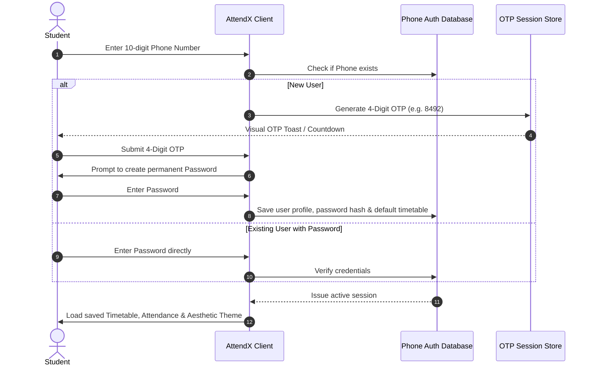

# 🌸 AttendX — Smart B.Tech Attendance Tracker & Bunk Calculator

> A cute, aesthetic, and intelligent attendance tracker tailored for university & college students. Track weekly timetables, calculate exact safe bunks to maintain 75% attendance, receive critical shortage & borderline warnings, authenticate via Phone Number + 4-Digit OTP / Password, and export academic reports into PDF and CSV.

---

## ✨ Key Features

### 1. 🧮 75% Attendance & Safe Bunk Engine
- **Safe Skip (Bunk) Calculation**: Accurately computes how many consecutive classes you can skip while remaining safely at or above the mandatory **75%** threshold:
  $$\text{Safe Bunks} = \left\lfloor \frac{\text{Attended} - 0.75 \times \text{Total}}{0.75} \right\rfloor$$
- **Catch-up Classes Needed**: If attendance drops below 75%, it calculates how many consecutive classes you must attend without missing:
  $$\text{Needed Classes} = \left\lceil \frac{0.75 \times \text{Total} - \text{Attended}}{0.25} \right\rceil$$
- **Smart Status Badges & Alerts**:
  - 🟢 **Safe Zone**: Attendance $\ge 80\%$
  - 🟡 **Borderline Warning**: Attendance between $75\%$ and $79.9\%$ (danger of falling into shortage)
  - 🔴 **Shortage Alert**: Attendance $< 75\%$ (detention risk notification)

### 2. 📅 Interactive Weekly Timetable Manager
- Easily customize weekly schedules from **Monday through Saturday**.
- Add, update, and manage subjects, classrooms, faculty names, and time slots.
- Live lecture indicator displaying currently ongoing and upcoming classes for the day.
- Timetable is permanently bound to the user's phone account in the database.

### 3. 📱 Phone Number + 4-Digit OTP & Password Sign-in
- **Phone Number as Primary Key**: Enter your 10-digit mobile number to log in or register.
- **4-Digit OTP Verification**: Instant 4-digit verification code with a realistic 60-second countdown and live OTP visualizer.
- **Permanent Password**: Set a secure password upon initial verification to quickly log in anytime without waiting for an OTP.
- **Persistent User Accounts**: Timetables and attendance data are linked directly to your phone number account.

### 4. 🗄️ Database Architecture & Live Database Explorer
- **Primary Key**: `phoneNumber` (unique identifier for every student).
- **Entities**:
  - `users`: User profile, credentials (`passwordHash`), student registration ID, department, semester.
  - `attendance_records`: Attended vs. total sessions, last updated timestamp, custom target percentage.
  - `timetable_slots`: Day of week, period timing, subject code, room number.
  - `otp_sessions`: Active 4-digit OTP codes, expiry countdown, verification status.
  - `active_session`: Currently authenticated student token and phone session.
- **In-App Live Database Explorer**:
  - Inspect live database collections and records in real time.
  - View table schemas, raw JSON dumps, and active OTP session storage.
  - Ready-to-deploy PostgreSQL DDL schema & Spring Boot JPA entity definitions.
  - One-click JSON backup export and sample demo data seeding.

### 5. 📄 Export Attendance Reports (PDF & CSV)
- **Official PDF Report**: Beautifully formatted academic attendance summary with student details, percentages, bunk quotas, and official signature blocks (built with `jspdf` and `jspdf-autotable`).
- **CSV Data Export**: Download raw attendance data for spreadsheets (Excel / Google Sheets) and offline record keeping.

### 6. 🎨 Cute, Aesthetic & Creative UI Themes
- **Theme Switcher**:
  - 🌸 **Pastel Blossom** (Soft pink, rose & blush)
  - 💜 **Kawaii Lavender** (Lilac, violet & soft amethyst)
  - 🍵 **Emerald Matcha** (Mint, sage & refreshing green)
  - 🍑 **Sunset Peach** (Warm amber, coral & peach)
  - 🌙 **Cyberpunk Dark** (Sleek dark mode with neon accents)
- **Cute Mascot & Encouragement Widget**: Playful animated reactions and motivational quotes based on your current attendance status.

### 7. ☕ Java Spring Boot Backend Architecture
- Complete Java 21 & Spring Boot 3.3.2 microservice located in `/backend`.
- RESTful APIs for student management, attendance calculations, and timetable management.
- OpenAPI / Swagger documentation support (`/swagger-ui.html`).
- Built-in interactive **Java API Console** emulator inside the app to test backend REST endpoints directly.

---

## 🛠️ Tech Stack

| Layer | Technology |
|---|---|
| **Frontend Framework** | React 19 (TypeScript, Vite) |
| **Styling** | Tailwind CSS v4, Lucide React Icons |
| **Animation** | Motion (Framer Motion) |
| **Report Generation** | jsPDF, jsPDF-AutoTable |
| **Database** | Persistent Client Storage + Live DB Explorer + PostgreSQL / Spring Data JPA Schema |
| **Backend Option** | Java 21, Spring Boot 3.3.2, Maven (located in `/backend`) |

---

## 🚀 Getting Started

### Prerequisites
- Node.js (v18 or higher)
- npm or yarn

### Frontend Setup & Development

1. **Install dependencies**:
   ```bash
   npm install
   ```

2. **Start the development server**:
   ```bash
   npm run dev
   ```
   Open your browser and navigate to `http://localhost:3000`.

3. **Build for production**:
   ```bash
   npm run build
   ```

4. **Lint and Typecheck**:
   ```bash
   npm run lint
   ```

---

## ☕ Running the Java Spring Boot Backend (Optional)

If you would like to run the standalone Spring Boot backend:

```bash
cd backend
mvn clean spring-boot:run
```

- API Base URL: `http://localhost:8080/api/v1`
- Swagger UI Documentation: `http://localhost:8080/swagger-ui.html`

---

## 📂 Project Structure

```
├── backend/                        # Java Spring Boot 3.3.2 enterprise backend
│   ├── pom.xml
│   ├── ARCHITECTURE.md
│   ├── README.md
│   └── src/main/java/com/btech/attendance/
├── src/
│   ├── components/                 # React UI components
│   │   ├── AttendanceCard.tsx      # Subject card with quick mark & bunk math
│   │   ├── CuteMascotCard.tsx      # Cute aesthetic mascot & dynamic quotes
│   │   ├── DatabaseExplorerModal.tsx # Live DB inspector, OTP store & schema viewer
│   │   ├── ExportReportModal.tsx   # PDF & CSV download modal
│   │   ├── JavaBackendConsole.tsx  # In-app Java REST API interactive console
│   │   ├── Navbar.tsx              # Navigation, theme picker, DB & API buttons
│   │   ├── NotificationCenter.tsx  # Shortage and borderline notification panel
│   │   ├── PhoneAuthModal.tsx      # Phone signin, 4-digit OTP & password setup
│   │   ├── TimetableModal.tsx      # Weekly timetable scheduler (Mon-Sat)
│   │   └── ...
│   ├── types/
│   │   └── attendance.ts           # Type definitions (Subject, Student, Timetable, etc.)
│   ├── utils/
│   │   ├── attendanceCalculations.ts # 75% bunk calculation formulas
│   │   ├── authDatabase.ts         # User DB, OTP engine, hashing & session manager
│   │   └── storage.ts              # Local persistence layer
│   ├── App.tsx                     # Main application container
│   ├── index.css                   # Global styles & Tailwind configuration
│   └── main.tsx                    # React entrypoint
├── metadata.json                   # Applet metadata
├── package.json                    # Project dependencies and npm scripts
└── README.md                       # Main project documentation
```

---

## 🔐 Authentication & Database Flow



---

## 📜 Academic Attendance Formula Summary

- **Attendance Percentage**:
  $$\% = \frac{\text{Attended Classes}}{\text{Total Held Classes}} \times 100$$
- **Safe Bunks Allowed ($B$)** to keep $\% \ge 75\%$:
  $$B = \left\lfloor \frac{A - 0.75 \times T}{0.75} \right\rfloor$$
- **Catch-up Classes Needed ($C$)** if $\% < 75\%$:
  $$C = \left\lceil \frac{0.75 \times T - A}{0.25} \right\rceil$$

---

## 💖 Contributing & Feedback
Made with 🌸 for B.Tech students to stress less, manage attendance easily, and stay above the 75% mark!
